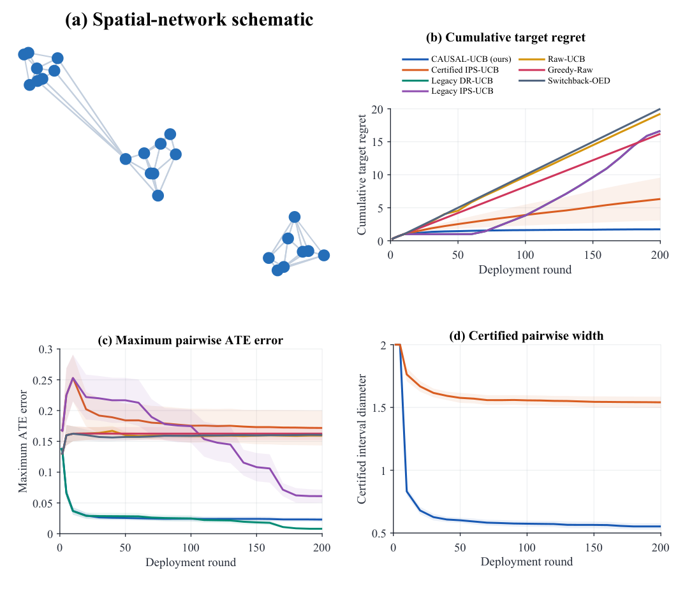

<div align="center">

# CAUSAL-UCB

### Online Causal Configuration for Networked Systems via Doubly Robust Steady-State Learning

**NeurIPS 2026 · Paper, implementation, reproducible benchmarks and interactive research website**

[**Paper (OpenReview)**](https://openreview.net/pdf?id=sO7mOWC5TC) · [**Interactive website**](https://ylliua1116.github.io/causal-ucb/) · [**Research poster**](docs/assets/poster/research-poster.pdf) · [**Hugging Face demo**](https://huggingface.co/spaces/ylliua1116/causal-ucb)

</div>

> **Research question.** When network configurations are explored using short-run, interference-affected observations, can we reliably select configurations for *steady-state deployment* rather than merely maximizing the observed exploratory reward?

CAUSAL-UCB studies **reliable online configuration decisions under network interference and exploration–deployment mismatch**. It combines causal evaluation of configuration values, doubly robust (DR) estimation, and calibrated optimism for sequential selection. The key benchmark deliberately stresses a regime where exploratory observations disagree with the target steady-state objective.

<p align="center"></p>
<p align="center"><sub>Figure from the accompanying manuscript; see the paper for the figure-specific protocol and interpretation.</sub></p>

## At a glance

| Research component | Where to start |
| :--- | :--- |
| **Core idea and guarantees** | [OpenReview paper](https://openreview.net/pdf?id=sO7mOWC5TC) |
| **Main evidence: High Mismatch** | [Results section](#main-result-high-mismatch) · [interactive plots](https://ylliua1116.github.io/causal-ucb/#results) |
| **Full matched-seed comparison** | [`src/fast_compare.py`](src/fast_compare.py) |
| **DR / IPS certified implementations** | [`src/cert_dr.py`](src/cert_dr.py) |
| **Recorded evidence and protocol** | [`docs/assets/certified-benchmark/`](docs/assets/certified-benchmark/) |
| **Audit trail for Low Mismatch replay** | [Reproducibility and data provenance](REPRODUCIBILITY.md) |
| **Local setup and deployment** | [Quick start](#quick-start) · [deployment guide](DEPLOYMENT.md) |

## Why this problem matters

A network controller can repeatedly choose a configuration, collect responses and update its estimates. Yet **the environment under exploration need not match the environment after deployment**. Local interactions among units and shifting exposure patterns can make a seemingly attractive exploratory reward an unreliable proxy for long-run value.

The CAUSAL-UCB workflow addresses three linked decisions:

1. **Identify the deployment target.** Evaluate configurations under the target, non-exploration steady-state distribution while accounting for interference.
2. **Learn with partial, interference-affected feedback.** Use a causal value estimator (including DR correction) to evaluate configurations from observed data.
3. **Select optimistically with calibrated uncertainty.** Use confidence information in online choices; report estimation quality and the exploration–deployment trade-off separately.

The certified experiments rely on the explicit experimental assumptions described in the paper and [`protocol.json`](docs/assets/certified-benchmark/protocol.json). The website's explanatory animations and adjustable browser lab are **separate from the recorded benchmark**.

## Main result: High Mismatch

**Primary benchmark** · `high_mismatch` · interference/exploration parameter `η = 0.55` · **24 matched seeds** · **200 rounds** · **7 methods**.

The following values are **24-seed means at round 200**, read from the frozen seven-method comparison file. Lower is better for regret, deployment gap and ATE error. *Optimal-selection rate* is the fraction of seeds ending at the target-best configuration.

| Method | Target regret ↓ | Cumulative deploy. gap ↓ | Final ATE error ↓ | Optimal selection ↑ | Certified width ↓ |
| :--- | ---: | ---: | ---: | ---: | ---: |
| **Certified CAUSAL-UCB (DR)** | 1.732 | 30.607 | 0.0230 | 100.0% | 0.552 |
| Certified IPS-UCB | 6.326 | 23.217 | 0.1718 | 75.0% | 1.541 |
| Reference CAUSAL-UCB | 16.647 | 12.279 | 0.0081 | 50.0% | — |
| Reference IPS-UCB | 16.647 | 12.279 | 0.0610 | 50.0% | — |
| Raw-UCB | 19.235 | 8.016 | 0.1595 | 12.5% | — |
| Greedy-Raw | 16.207 | 4.120 | 0.1626 | 0.0% | — |
| Switchback-OED | 20.000 | 9.215 | 0.1604 | 0.0% | — |

**What this establishes.** In this controlled high-mismatch regime, Certified CAUSAL-UCB (DR) has the lowest mean cumulative target regret (**1.732**) and selects the target-best configuration in all 24 seeds. Relative to the certified IPS alternative (6.326), this is a **72.6%** reduction in the observed mean regret. It does **not** simultaneously minimize the cumulative deployment gap (30.607); that is a distinct objective and an important trade-off. Likewise, final ATE error and online selection regret answer different questions: the method with the lowest terminal estimation error need not have the lowest regret.

**Boundary check.** Under `low_mismatch` (`η = 0.08`), Greedy-Raw has mean regret **1.000** versus **1.018** for Certified DR. The paper's claim is therefore **reliability under meaningful exploration–deployment mismatch**, not universal dominance in every regime. Both experimental settings remain available on the website.

### What the metrics mean

- **Target regret:** cumulative loss in target steady-state value relative to the target-best configuration; computed with an evaluation oracle after each decision.
- **Cumulative deployment gap:** accumulated difference between the target and logged/exploratory values of configurations actually selected. It is reported separately from regret.
- **Final ATE error:** terminal maximum pairwise effect-estimation error; the archive does not treat it as a recorded per-round trajectory.
- **Certified width:** valid decision-active width **only for the two certified policies**. Other methods may have diagnostic interval calculations, but those are not equivalent certificates.
- **Optimal-selection rate:** proportion of the 24 seeds whose final configuration is target-optimal; it is not the same as the modal configuration count.

## Quick start

**Prerequisite:** Python 3.10+ (CPU is sufficient for the bundled benchmark); NumPy is the only dependency declared by this repository.

```bash
# From the repository root
python -m pip install -r requirements.txt
python -m unittest discover -s src/tests -v

# Fast smoke test: high-mismatch scenario, one seed, 35 rounds
python src/fast_compare.py --out results_smoke --seeds 1 --T 35 --scenarios high_mismatch
```

Run the matched-seed **main High Mismatch** comparison:

```bash
python src/fast_compare.py --out results_high --seeds 24 --T 200 --scenarios high_mismatch
```

Run both documented regimes:

```bash
python src/fast_compare.py --out results_full --seeds 24 --T 200 --scenarios high_mismatch,low_mismatch
```

The driver writes `per_seed.csv`, `summary.csv`, `protocol.json`, and certified-policy per-round traces to the selected output directory. For the complete frozen seven-method trajectories used by the website, see [Reproducibility](REPRODUCIBILITY.md); the reference-method per-round archive/replay workflow is documented separately from the base driver output.

## Repository map

```text
.
├── README.md                         # Research overview, primary evidence, quick start
├── REPRODUCIBILITY.md                # Data provenance, replay verification, limits
├── DEPLOYMENT.md                     # GitHub Pages and local site hosting
├── WEBSITE_GUIDE.md                  # How to interpret the public interactive site
├── requirements.txt                  # Python dependency declaration
├── src/
│   ├── cert_dr.py                    # Certified DR and IPS policy implementations
│   ├── fast_compare.py               # Matched-seed seven-method driver
│   ├── original_source/             # Conditional online-learning model
│   ├── replay_missing_rounds.py      # Deterministic Low Mismatch replay and checks
│   ├── build_replayed_comparison.py  # Merge verified replay into website JSON
│   └── tests/                        # Policy and provenance checks
└── docs/                              # Static GitHub Pages website
    ├── index.html
    ├── live-lab/                     # Independent browser Python demonstration
    └── assets/
        ├── certified-benchmark/     # Protocol, CSV, replay audit, website JSON
        ├── paper-figures/           # Manuscript figures
        └── poster/                  # Research poster PDF
```

## Reproducibility and evidence integrity

The published comparison includes seven methods under both mismatch conditions, but the **origin of per-round traces differs**:

| Regime | Certified DR / IPS traces | Other five methods |
| :--- | :--- | :--- |
| **High Mismatch** (`η=0.55`) | Archived 200-round trajectories | Archived 200-round trajectories |
| **Low Mismatch** (`η=0.08`) | Archived 200-round trajectories | Deterministically **replayed** 200-round trajectories, verified against original terminal records |

The Low Mismatch replay generated **24,000 new round rows** (5 methods × 24 seeds × 200 rounds). The audit reports **168/168 verified decision-sequence SHA-256 comparisons** across all seven methods and 24 seeds, with zero difference in the checked terminal quantities. These are *verified replays*, not newly discovered original logs. For the audit files and reproducibility commands, see [`REPRODUCIBILITY.md`](REPRODUCIBILITY.md).

Do not use the browser lab's tunable five-policy conditional experiment as if it were a rerun of the seven-method, matched-seed certified benchmark.

## Interactive research site

The [`docs/`](docs/) static site presents the scientific narrative, figure atlas (including paper Figures 3–7), the 24-seed benchmark with selectable methods and rounds, CSV exports, the poster, and an optional browser Python lab. It can be hosted using GitHub Pages from `main /docs`. The benchmark's **High Mismatch view is the scientific centerpiece**; Low Mismatch serves as a boundary case.

For site-specific guidance, see [Website guide](WEBSITE_GUIDE.md) and [Deployment](DEPLOYMENT.md). The paper entry points use the [official OpenReview PDF](https://openreview.net/pdf?id=sO7mOWC5TC).

## Scope, citation and permissions

- **Scientific scope:** known radius-one local ring interference; controlled stationary generator and calibration/noise conditions. The claims should not be extended to unknown or arbitrary networks without additional analysis.
- **Artifact scope:** this repository includes the benchmark driver, executable policies, selected manuscript figures, fixed website data and relevant integrity checks. It is not a claim to include every intermediate artifact for the entire manuscript.
- **Citation:** please cite the [official NeurIPS 2026 paper record](https://openreview.net/forum?id=sO7mOWC5TC) and use its official author list and BibTeX metadata. The paper PDF is available [here](https://openreview.net/pdf?id=sO7mOWC5TC).
- **License:** no open-source license is included in this release. Public access to the repository does not by itself grant a reuse license; contact the maintainers for permissions.
